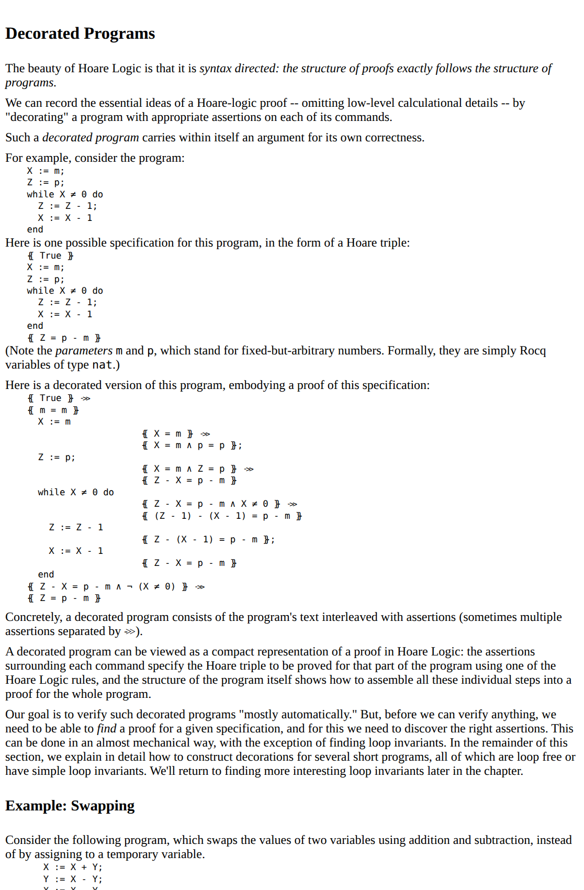

# Software Foundations as EPUB

Unofficial EPUB editions of [Software Foundations](https://softwarefoundations.cis.upenn.edu/)
Volume 1, *Logical Foundations*, and Volume 2, *Programming Language Foundations*, for reading
on e-readers such as Apple Books. Each book is built from the official HTML of the current
release (7.1 at the time of writing), and the scripts that build it are here.

**Download:** the EPUBs are on the [Releases](../../releases) page.

This project is not affiliated with or endorsed by the book's authors. The official edition is
the website. The book is meant to be worked through interactively in the Rocq prover, so read
here, but do the exercises with the `.v` files from the official site.

## What the conversion changes

| | Website, converted as is | This edition |
|---|---|---|
| Proofs | Folded away behind "+" buttons that need JavaScript | Shown in full, with a line down the left side |
| Identifiers in code | Links, many with targets that are invalid in an EPUB | Coloured text, not links, so a tap doesn't jump elsewhere |
| Page | The website's background photo and navigation | Plain, so the reader's white, sepia and night themes work |
| Long code lines | Wrap back to the margin | Wrap with an indent, so a continued line is distinct from a new one |
| Contents | Chapters only | Chapter, section and subsection |
| Cover | A generated placeholder | The volume's own cover, as on the book's home page (from the official download) |

The text itself is unchanged. `build.sh` compares every chapter word for word with the official
HTML and stops if any word is lost or added.

There is one fix to the source. In PLF's `Hoare2` an italic is opened and never closed, which
would set the rest of the chapter in italics; it is closed at the end of its paragraph.

| Converted as is (Calibre, no changes) | This edition |
|---|---|
|  |  |

Each book ends with an "About this edition" page that gives the version, what was changed,
and the book's licence notice.

## Building

```sh
./build.sh          # both volumes, into out/
./build.sh lf       # Volume 1 only
REFRESH=1 ./build.sh   # download the book again after a new release
```

`build.sh` downloads the current release of each volume from the official site. It uses
Calibre's `ebook-convert` and `calibre-debug` if they are on `PATH` (on macOS they are in
`/Applications/calibre.app/Contents/MacOS`). Otherwise, on x86-64 Linux, it downloads a pinned,
checksum-verified portable Calibre into `.cache/`. If Java is installed, it then validates each
book with a pinned [epubcheck](https://github.com/w3c/epubcheck). The 7.1 books give 1 and 3
errors, all harmless: a link anchor placed directly inside a list, and a bookmark whose target
does not exist.

- `scripts/clean_sf.py`: the clean-up. Regular expressions handle what is specific to coqdoc,
  then an HTML5 parser repairs the markup the way a browser would, and the result is written as
  XHTML.
- `scripts/compare_text.py`: the word-for-word check.
- `scripts/fix_author_sort.py`: gives each author their own sort key. Calibre writes one
  sort string onto every author.
- `scripts/shot.sh`: screenshots a page of a built book at an iPad mini's width in headless
  Chrome, for checking layout.

## Licences

The scripts are under the MIT licence in [`LICENSE`](LICENSE).

Software Foundations itself is distributed by its authors under the MIT licence included in its
source distribution. Each EPUB reproduces that notice on its last page, as the licence requires.

The book asks readers not to post solutions to its exercises in public places. This repository
contains none, and contributions to it should not add any.
